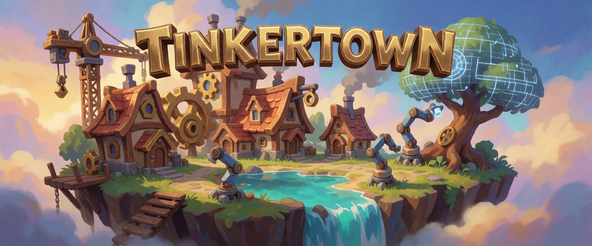

# Tinkertown

En speleditor där man spelar hela tiden. WASD, mouselook, spring, flyg, interagera och attack finns från start, och varje del av världen kan genereras inifrån editorn.

Tricket: AI:n gör inga tunga lyft. Den skickar små recept till verktyg (egna eller open source) som bygger träd, terräng, vatten, props, karaktärer och texturer. Ett träd ska kosta några hundra tokens, inte tiotusentals.

## Principer

1. **Världen är data.** Allt sparas som recept (parametrar + seed), inte som färdiga meshar. Små filer, reproducerbart, och AI:n kan ändra "gör träden högre" genom att ändra en siffra.
2. **Verktyg med höga verb.** `place_forest`, `carve_river`, `create_tree`, inte `create_vertex`.
3. **Korta svar till AI:n.** Verktyg svarar med en rad JSON (id, antal, sökväg), aldrig med geometri. Bilder bara när det behövs.
4. **Enhetlig stil.** Stiliserad, halvrealistisk mid-poly i stil med Overwatch och Fortnite. Se [stilguiden](docs/style-guide.md); värden som verktygen läser finns i [`tools/style.json`](tools/style.json).
5. **Bygg själv bara när inget bra gratis verktyg finns.**

## Plattform och arkitektur

- **Renderare:** [Three.js](https://threejs.org). Tinkertown är ett eget motorlager ovanpå: editor, spelläge, världsrecept och verktygsregister. Ingen egen renderare.
- **Mål 1, webbläsaren:** spelet och editorn körs i en vanlig webbläsare.
- **Mål 2, desktopapp:** samma kod paketeras senare med [Electron](https://www.electronjs.org). Electron har med sig en egen Chromium, så WebGPU och WebGL beter sig likadant överallt. (Tauri valdes bort: på Linux använder det WebKitGTK, med svagare WebGPU- och WebGL-stöd.)

Koden delas från början i två delar, så att båda målen fungerar utan omskrivning:

| Del | Gör | I webbläsaren | I desktopappen |
|---|---|---|---|
| Klient | Three.js-spel och editor, spelaren och UI | Webbsida | Electron-fönster |
| Lokal server (Node) | Sparar världsrecept, kör verktygen (trädgeneratorn, Blender, ComfyUI), MCP-server för AI-agenter | Separat process på `localhost` | Electrons Node-del |

Klienten pratar bara med servern via ett eget API. Den anropar aldrig verktyg direkt.

## Status

Hela planen, med alla generatorer, biblioteket, terrängredigering, spelsystem och GUI, finns i [roadmap](docs/roadmap.md).

| Område | Verktyg | Status |
|---|---|---|
| Träd | Egen generator (`tools/tree/`): skelett, bark, lövverk | v3: allt växer ur ett skelett och kontrolleras (anslutna grenar, fäst lövverk). Arter som data i `species.json`; 3 LOD → GLB |
| Ytor | `tools/texture/make_surface.py` | Sömlösa marktexturer + normalkartor (`generate_surface`) |
| Naturprops | Egen generator (`tools/props/`) | Stenar, bumlingar, mossa, svampar, stubbar, lövhögar, krypväxter → GLB (`create_prop`) |
| Byggnader | Egen generator (`tools/building/`) | Hus, värdshus, torn, stadshus och butiker i sex spelstilar och tre stiliseringsgrader, från recept; texturer genereras vid behov (`create_building`) |
| Texturer | Krea-2 Turbo via lokal ComfyUI | Fungerar: bark (sömlös), lövsprite (alfa) |
| MCP-server | `tools/mcp/server.py` | Fungerar: `create_tree`, `generate_texture`, `generate_leaf_atlas`, `list_assets` |
| Terräng, vatten, vegetation, props, karaktärer | – | Ej påbörjat |
| Editor/runtime | Three.js | Ej påbörjat (motor vald) |
| Desktopapp | Electron | Senare |

## Struktur

```
tools/mcp/        MCP-servern som exponerar verktygen för AI-agenter
tools/tree/       trädgeneratorn: arter (species.json), skelett, bark, lövkrona, gran
tools/texture/    Krea-2-generering och efterbehandling (sömlöst, alfa)
assets/textures/  delade, stiliserade texturer (raw/ = original från Krea-2)
assets/trees/     genererade träd: <namn>.gltf + .bin (texturer delas från assets/textures/), recipe.json, förhandsbild
docs/concept/     konceptbilder
build/            mellanfiler (OBJ m.m.), ignoreras av git
```

## Visningssidor

`showcase/park.html` placerar allt i en liten park med stigar och blandad mark.

`showcase/byggnader.html` visar byggnadsgeneratorns hus på rad (`?m=namn1,namn2` väljer vilka).

`showcase/skogen.html` är banan Skogen: en tät granskog med stig och gläntor, ritad instansierat med LOD per avstånd (`showcase/instancing.js`). Storleken kan ökas (`?size=2` ger 4× yta). Se [prestandarapporten](docs/skogen-prestanda.md).

## Visningssida

`showcase/index.html` visar allt generatorerna har gjort, på rader i en Three.js-scen med skuggor, vind (från `_WIND`) och LOD-växling. Bygg katalogen och starta en lokal server:

```bash
python3 -I tools/showcase/build_catalog.py
```

```bash
python3 -m http.server 8765 --bind 127.0.0.1
```

Öppna sedan http://localhost:8765/showcase/index.html.

## Kom igång

Krav: Node 18+, Blender 5.2 (Flatpak räcker), uv, och ComfyUI på `127.0.0.1:8188` för texturer.

```bash
cd tools/tree && npm install && cd ../..
```

### Via MCP (det normala sättet)

Projektets `.mcp.json` registrerar servern `tinkertown`, som startas med `uv run --script tools/mcp/server.py` (beroenden installeras automatiskt av uv). Claude Code frågar om servern ska godkännas första gången projektet öppnas.

| Verktyg | Exempel | Svar |
|---|---|---|
| `create_tree` | `{"name":"cherry_v2","preset":"ash_medium","seed":5,"height":7,"leaves":"blossom_atlas"}` | `{"model": "assets/trees/cherry_v2/cherry_v2.gltf", "clusters": 14, "tris_lod": [18720, 13820, 10992], ...}` |
| `generate_texture` | `{"name":"pine_bark","prompt":"pine bark, flaky reddish plates","kind":"tile"}` | `{"path": "assets/textures/pine_bark.png", "seed": ...}` |
| `generate_leaf_atlas` | `{"name":"maple_atlas","prompt":"a dense cluster of autumn orange maple leaves on a short twig"}` | `{"atlas": "assets/textures/maple_atlas.png", ...}` |
| `list_assets` | `{}` | `{"trees": [...], "textures": [...]}` |

`generate_texture` lägger automatiskt till husets stil (`house_style=true`) och rätt instruktioner för `tile` (sömlös yta) eller `cutout` (sprite med alfa på vit bakgrund).

### Direkt från kommandoraden

Ett träd:

```bash
python3 -I tools/tree/make_tree.py '{"name":"oak42","preset":"oak_medium","seed":42,"height":9}'
```

Svar: `{"model": "assets/trees/oak42/oak42.gltf", "height_m": 9.0, "branch_tris": 3166, "leaf_tris": 10640, ...}`

Presets: `<art>_<small|medium|large>` där arterna finns i `tools/tree/species.json`: oak, maple, ash, aspen, birch, cherry, willow, acacia, cypress, jpine, pine (gran), palm, deadtree, shrub, bush (även `bush_1..3`), de stamlösa `ballbush` och `moundbush`, och bladkupolerna `leafbush`, `petalbush` och `serratebush`. En ny art läggs till som data, utan kodändring. Svaret innehåller `checks` med `ok: true` när växten hänger ihop.

```bash
python3 -I tools/tree/make_tree.py '{"name":"oak_wide","preset":"oak_medium","seed":7,"height":8,"species":{"levels":[{"count":[7,9],"angle":[58,10]}]}}'
```

En ny textur:

```bash
python3 -I tools/texture/krea2.py "<prompt>" 1024 1024 assets/textures/raw/<namn>_raw.png
```

```bash
uv run --no-project --python 3.12 --with pillow==11.1.0 --with numpy==2.2.3 python -I tools/texture/post_textures.py tile assets/textures/raw/<namn>_raw.png assets/textures/<namn>.png
```

(`cutout` i stället för `tile` för sprites på vit bakgrund, som löv.)
